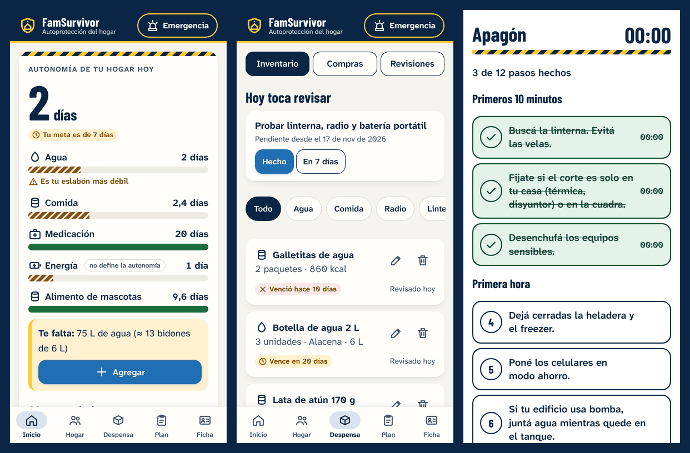
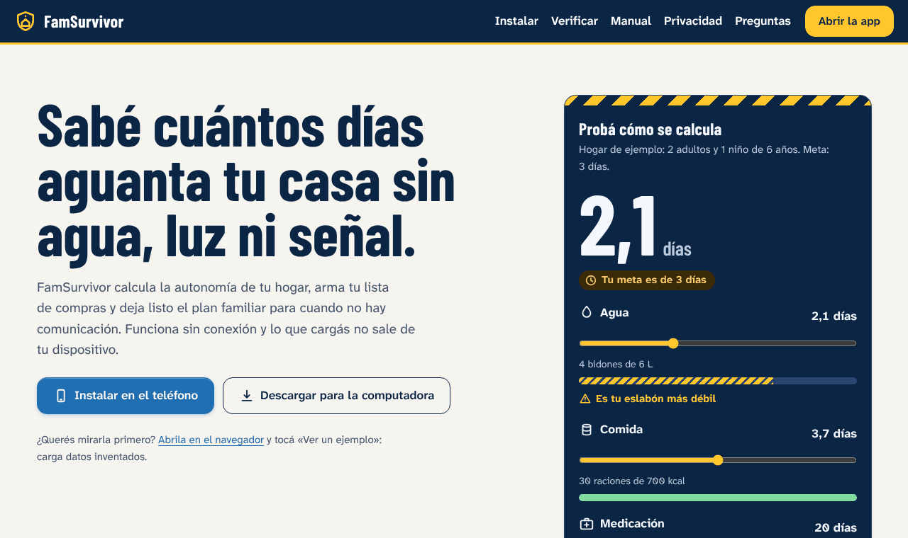

# FamSurvivor — autoprotección del hogar

**Sabé cuántos días aguanta tu casa sin agua, luz ni señal, y dejá listo el plan familiar para cuando no hay comunicación.**

FamSurvivor (FamilySurvivor) es una app web gratuita para preparar hogares ante cortes de servicios, tormentas, inundaciones, calor extremo y otras emergencias. Calcula la autonomía de tu casa, arma la lista de compras, organiza quién hace qué y te guía paso a paso durante una emergencia. Funciona sin conexión y lo que cargás no sale de tu dispositivo.



## Qué hace

- **Inicio:** tu autonomía en días, el recurso que primero se acaba («tu eslabón más débil»), lo que te falta comprar y hasta tres cosas para hacer hoy.
- **Hogar:** quiénes viven en casa (con alias, nunca nombres completos), su medicación y las amenazas de tu zona, con qué hacer antes, durante y después.
- **Despensa:** inventario con vencimientos, lista de compras que sale sola de lo que falta y revisiones periódicas que podés llevar al calendario del teléfono.
- **Plan:** puntos de encuentro, ventana de comunicación, teléfonos de emergencia de tu país, roles y simulacros con cronómetro.
- **Ficha:** tarjeta de billetera, hoja para la heladera y checklist de mochila para imprimir; respaldos cifrados, privacidad, idioma y modo de pantalla (automático, día, noche o ahorro de batería).
- **Modo Emergencia:** un botón siempre visible. Elegís qué está pasando y ves los pasos en orden, con tus teléfonos y puntos de encuentro a mano.
- **En cuatro idiomas:** español, inglés, portugués y francés, incluidas las guías y los pasos de emergencia. Se elige en la bienvenida o en Ficha.

## Cómo usarla

- **En el teléfono:** abrí el sitio del proyecto (el enlace está en la descripción de este repositorio), tocá «Abrir la app» e instalala desde el navegador. Queda con su ícono y funciona sin conexión.
- **En la computadora:** instalala desde Chrome o Edge, o descargá el archivo `.html` y abrilo con doble clic.

No pasa por tiendas de aplicaciones, no pide cuentas y no tiene publicidad.



## Privacidad

- **Sin servidor ni cuentas:** todo queda en el almacenamiento del navegador, en tu teléfono o tu computadora.
- **Sin conexiones:** la app no usa analíticas, notificaciones push ni servicios de terceros, y su política de seguridad (CSP con `connect-src 'none'`) le impide enviar datos a ningún sitio.
- **Sin datos de más:** no pide nombres, documentos ni ubicación exacta, y no usa el GPS.
- **Cifrado opcional:** con una frase de acceso (AES-GCM de 256 bits, clave derivada con PBKDF2-SHA-256 y 600.000 iteraciones). Sin la frase no hay forma de recuperar los datos.

## Descarga verificable

El archivo para la computadora es **idéntico, byte por byte,** a [`source/famsurvivor_standalone.html`](source/famsurvivor_standalone.html). Esta es su huella SHA-256:

<!-- sha256:inicio -->

| Archivo | Versión | Tamaño | SHA-256 |
| --- | --- | --- | --- |
| `FamSurvivor-v2.html` | 2.1.0 | 483 KB | `8bb01db84c1ff60b0d8055230f53abc3094ea3ce8921e55396245e76d665a7ae` |

<!-- sha256:fin -->

Para comprobar el archivo que descargaste, abrí una terminal en la carpeta donde quedó y corré:

| Sistema | Comando |
| --- | --- |
| Windows (PowerShell) | `Get-FileHash .\FamSurvivor-v2.html -Algorithm SHA256` |
| macOS | `shasum -a 256 FamSurvivor-v2.html` |
| Linux | `sha256sum FamSurvivor-v2.html` |

Tiene que dar exactamente la huella de arriba (Windows la muestra en mayúsculas: da lo mismo). El sitio publica la misma huella en su sección «Verificar», junto con las de los archivos de la app instalable. El build es reproducible: con este repositorio, cualquiera puede volver a calcularlas.

## Cómo está hecha

- Un solo archivo HTML con su CSS y su JavaScript, sin frameworks ni dependencias. Funciona abierto como archivo y como PWA instalable.
- Datos locales (IndexedDB, con respaldo en `localStorage`), cifrado con la Web Crypto API del navegador y respaldos `.fsbackup` o `.json`.
- Sitio estático en Vercel: landing con manual, PWA en `/app/` con Service Worker y la descarga en `/descargas/`.
- Accesible: probado con axe-core (WCAG 2.2 AA) en los cuatro idiomas y en los modos día, noche y ahorro de batería, objetivos táctiles de 44 px y texto grande opcional.
- Tipografías Atkinson Hyperlegible Next (pensada para baja visión) y Barlow Condensed, incluidas en el archivo: sin pedidos a otros sitios.
- Traducciones en `i18n/`, validadas e incrustadas en la app por `npm run i18n`.
- 34 pruebas de los cálculos y de los idiomas dentro de la app (`/app/?selftest`), 14 comprobaciones del build y 40 pruebas en navegador.

## Para desarrollar

Hace falta Node 22 o más nuevo (recomendado: la versión LTS actual). No hay dependencias que instalar.

```bash
npm run dev       # arma el sitio y lo sirve en http://localhost:4173
npm run release   # sella la CSP, actualiza la huella de este README, arma y comprueba
```

- [docs/DESARROLLO.md](docs/DESARROLLO.md): cómo está armado el build, la CSP por huellas, las pruebas y los límites conocidos.
- [docs/PUBLICAR.md](docs/PUBLICAR.md): subir el repositorio a GitHub, publicarlo en Vercel y sacar versiones nuevas.
- [CHANGELOG.md](CHANGELOG.md): qué cambió en cada versión.

## Aviso

FamSurvivor es una ayuda para organizarte. **No reemplaza las indicaciones de las autoridades ni el consejo médico.** En una emergencia real, seguí las instrucciones oficiales y llamá a los servicios de emergencia de tu zona. Cada cifra y cada guía de la app indica su fuente y cuánto se pudo verificar; lo marcado como pendiente conviene contrastarlo con tu Defensa Civil o tu municipio.

## Créditos

**Diseñado por [Jagā Soluciones Informáticas](https://jagasoluciones.com/)** — Corrientes, Argentina.

Tipografías del sitio: Barlow Condensed y Atkinson Hyperlegible Next, con licencia SIL Open Font License 1.1 (textos en `site/fonts/`). Las pruebas usan axe-core de Deque Systems (MPL 2.0).

© 2026 Jagā Soluciones Informáticas.
