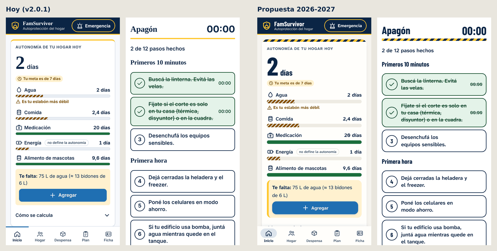
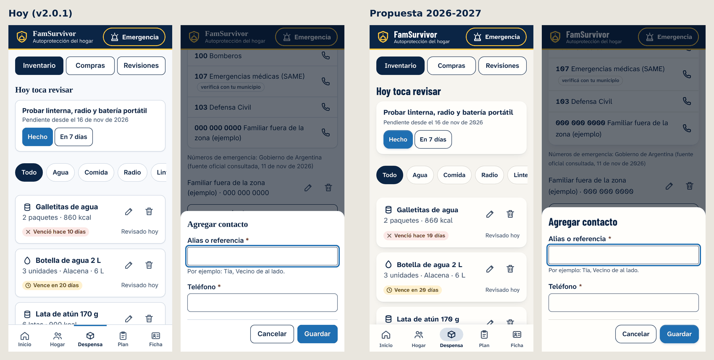
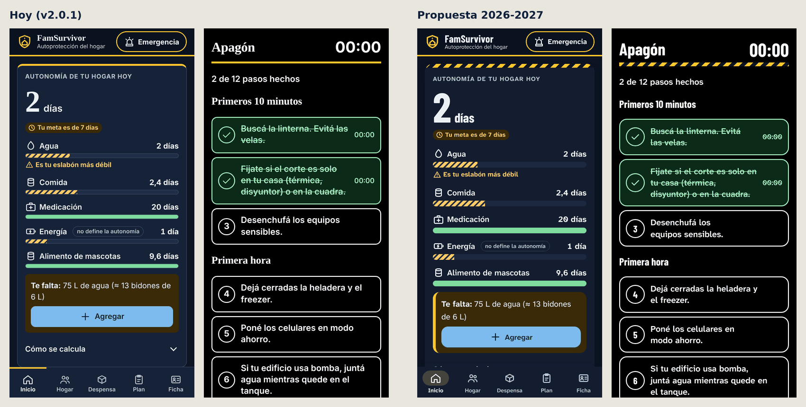
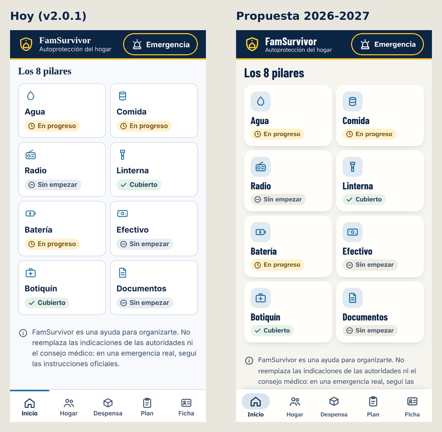

# Propuesta visual 2026-2027 — «señalética cálida»

Una capa de estilos **solo CSS** para la app: no cambia la estructura, el código ni los datos.

**Aplicada desde la versión 2.1.0**, en la app y en el sitio, con las tipografías incluidas. Este archivo y `skin.css` quedan como referencia de qué se cambió y por qué; las capturas comparan la 2.0.1 con la propuesta.

| Antes y después | |
| --- | --- |
| Inicio y Modo Emergencia |  |
| Despensa y formulario |  |
| Modo oscuro |  |
| Los 8 pilares |  |

## Qué cambia

1. **Las mismas tipografías que el sitio:** Atkinson Hyperlegible Next para leer (pensada para baja visión) y Barlow Condensed para títulos y números grandes. Hoy la app usa la serif del sistema y el sitio otra cosa: no parecen del mismo proyecto.
2. **Papel cálido** en vez del gris azulado frío, con el mismo azul marino y el mismo amarillo de seguridad.
3. **La cinta de peligro amarilla y azul marino** (la de la señalética de seguridad) como firma visual: arriba de la autonomía, debajo del título del Modo Emergencia y en el pie.
4. **Profundidad que explica, sin vidrio:** tarjetas con sombra suave en lugar de bordes grises, íconos de los pilares en «placas», botones que se hunden al tocarlos.
5. **Barra de pestañas con indicador activo** (una pastilla detrás del ícono), más fácil de ver de un vistazo.
6. **Hojas que suben** al abrir un formulario, solo con CSS y solo si el teléfono no pide reducir el movimiento.
7. **Número de autonomía más grande**, en la letra condensada.
8. **Íconos con trazo de 2 px** y títulos que se cortan mejor (`text-wrap: balance` y `pretty`).

Más adelante (no incluido acá): pasar los tokens de color a OKLCH con `light-dark()`, para simplificar los temas claro, oscuro y Negro puro.

Probada con axe-core en claro y oscuro, a 320 y 390 px: sin errores de accesibilidad ni desbordes.

## Cómo aplicarla

1. Al final del `<style>` de `source/famsurvivor_standalone.html`, pegá:
   - las dos `@font-face` que están comentadas al principio de `skin.css`, con las tipografías en base64: `atkinson-hyperlegible-next-latin-wght-normal.woff2` y `barlow-condensed-latin-700-normal.woff2`, de `site/fonts/` (en Linux: `base64 -w0 site/fonts/<archivo>`);
   - el contenido de `skin.css`.
2. En la etiqueta `<meta http-equiv="Content-Security-Policy">` de la app, sumá `font-src data:`.
3. Subí la versión (por ejemplo, `2.1.0`) en el código de la app (`dn="2.1.0"`) y en `site.config.json`.
4. `npm run release`, probala y publicá.

Estos pasos están probados de punta a punta en una copia del proyecto: `npm run release` pasa sus 14 comprobaciones y las fuentes cargan con la CSP real, sin errores, en la descarga y en `/app/`. La descarga pasa de 220 KB a 299 KB, casi todo por las tipografías.

Si preferís no sumar peso, salteá el punto 1 y no toques la CSP: el resto funciona igual con las tipografías del sistema (el número grande usa entonces la letra condensada que tenga el teléfono, si tiene alguna).
